# COZY COMFORT: SERVICE-ORIENTED ARCHITECTURE & COMPUTING DESIGN SPECIFICATION

This specification outlines the complete, production-quality Service-Oriented Architecture (SOA) and Service-Oriented Computing (SOC) solution for **Cozy Comfort**.

---

## 1. Phase 1 – Solution Analysis

### 1.1 Business Entities
1. **Manufacturer (Cozy Comfort)**: The production facility that produces blankets, manages raw material stock, tracks production capacity, and handles wholesale ordering.
2. **Distributor**: Regional hubs that purchase bulk inventory from Cozy Comfort, store items in regional warehouses, and manage logistics and shipping to sellers.
3. **Seller**: Local retailers that interact directly with end customers, take customer orders, and manage local retail inventory.
4. **Blanket (SKU)**: The product catalog item. It features a unique SKU, material (e.g., Flannel, Sherpa, Wool, Fleece), price, and category.
5. **Inventory**: The physical stocks stored at each tier.
6. **Customer Order**: A retail request containing order items, customer details, and total payment.
7. **Purchase Order (Upstream)**: An automated wholesale request generated between Seller ➡️ Distributor or Distributor ➡️ Manufacturer to replenish stock.
8. **Production Request**: An internal factory order generated at the Manufacturer tier when stock runs out. It triggers factory lines.
9. **Notification Event**: Dynamic alerts published across the system.

### 1.2 Actors
*   **Manufacturer Admin / Production Scheduler**: Schedules factory queues, monitors raw materials, and manages factory output rates.
*   **Distributor Logistics Coordinator**: Manages warehouse inventories and coordinate freight/shipping logistics to Sellers.
*   **Seller Front Desk / Web Customer**: Browses catalog items, places orders, and receives dynamic delivery timelines.

### 1.3 Workflows
#### Traditional Manual Workflow
```
Customer ──> Places Order ──> Seller (Checks Stock) 
                                 │
                                 └──> [If Out] Calls/Emails Distributor (Checks Warehouse)
                                                         │
                                                         └──> [If Out] Calls/Emails Cozy Comfort (Checks Factory)
                                                                                 │
                                                                                 └──> Factory Schedules Production
```
*Communication is asynchronous, slow, and non-transparent, resulting in long waiting times for information to flow back.*

#### Service-Oriented Automated Workflow
```
Customer ──> checkout() ──> Seller Service (Checks Local Db)
                              │
                              └──> [Deficit] ──> GET /check-stock ──> Distributor Service (Checks Warehouse Db)
                                                                         │
                                                                         └──> [Deficit] ──> GET /check-capacity ──> Manufacturer Service
                                                                                                                      │
                                                                                                                      └──> Production capacity check
```
*Synchronous or asynchronous REST endpoints calculate stock deficits and dynamic lead times in milliseconds.*

### 1.4 System Pain Points
1. **High Communication Latency**: Manual phone calls and emails delay order processing.
2. **Lack of Inventory Transparency**: Sellers cannot see distributor stock levels, and distributors cannot see factory queues.
3. **Single Point of Failure (SPOF)**: A failure at any manually coordinated node breaks the entire fulfillment chain.
4. **No Dynamic Lead Time Tracking**: Customer delivery estimates are static guesses.
5. **Data Inconsistency**: Disconnected paper/Excel records lead to discrepancies.

### 1.5 Service-Oriented Transformation
By introducing decoupled REST/JSON APIs, Cozy Comfort gains:
*   **Automated Stock Escalation**: Deficits trigger automatic upstream API checks.
*   **Isolated Databases**: Each tier controls its own database.
*   **Dynamic Lead Time Estimation**: Manufacturer calculations are computed in real-time.
*   **Audit Trails**: Request tracking via centralized correlation tokens.

---

## 2. Phase 2 – Service Design

We isolate five microservices.

```
┌──────────────────────────────────────────────────────────────────────────────┐
│                                 SOA SERVICES                                 │
├───────────────────┬───────────────────┬───────────────────┬──────────────────┤
│  Seller Service   │  Distributor Svc  │ Manufacturer Svc  │ Notification Svc │
│ (Retail & Orders) │(Logistics/Wareh.) │(Factory/Capacity) │ (PubSub Alerts)  │
└─────────┬─────────┴─────────┬─────────┴─────────┬─────────┴─────────┬────────┘
          │                   │                   │                   │
  ┌───────▼───────┐   ┌───────▼───────┐   ┌───────▼───────┐   ┌───────▼───────┐
  │   Seller Db   │   │  Distributor  │   │ Manufacturer  │   │ Notification  │
  │               │   │      Db       │   │      Db       │   │      Db       │
  └───────────────┘   └───────────────┘   └───────────────┘   └───────────────┘
```

### 2.1 Seller Service
*   **Purpose**: Manages retail catalog listings, order processing, and customer checkouts.
*   **Database Tables**: `Sellers`, `Orders`, `OrderItems`, `RetailInventory`.
*   **API Endpoints**:
    *   `POST /api/fulfillment/check-stock`
    *   `POST /api/fulfillment/place-order`
    *   `GET /api/fulfillment/inventory`
*   **Models**:
    *   `FulfillmentRequestItem { ProductId: string, Quantity: int }`
    *   `SupplyChainQueryResponse { ProductId: string, RequestedQuantity: int, AvailableQuantity: int, TotalLeadTimeDays: int, PricePerUnit: decimal, Traces: List<TraceNode> }`
*   **Relationships**: Connects to the `Distributor Service` when local inventory cannot meet customer demand.

### 2.2 Distributor Service
*   **Purpose**: Tracks regional warehouse levels and manages delivery logistics.
*   **Database Tables**: `Distributors`, `DistributorInventory`, `UpstreamPurchaseOrders`.
*   **API Endpoints**:
    *   `POST /api/distributor/check-stock`
    *   `POST /api/distributor/reserve`
*   **Relationships**: Invoked by the `Seller Service`. Calls the `Manufacturer Service` if distributor warehouse inventory is depleted.

### 2.3 Manufacturer Service
*   **Purpose**: Manages factory production, warehouse stock, and scheduling.
*   **Database Tables**: `ManufacturerInventory`, `ProductionRequests`.
*   **API Endpoints**:
    *   `POST /api/manufacturer/check-capacity`
    *   `POST /api/manufacturer/order`
*   **Relationships**: Invoked by the `Distributor Service`. Computes dynamic assembly queue times based on fabric types.

### 2.4 Production Capacity Service
*   **Purpose**: Tracks raw materials and daily production limits.
*   **Database Tables**: `ProductionLines`, `CapacitySchedules`.
*   **API Endpoints**:
    *   `GET /api/production/capacity?productId=blanket-001`
*   **Relationships**: Internal sub-service of the `Manufacturer Service`.

### 2.5 Notification Service
*   **Purpose**: Sends transactional notifications (Email/SMS) to customers and partners.
*   **Database Tables**: `NotificationLogs`, `TemplateRegistry`.
*   **API Endpoints**:
    *   `POST /api/notifications/send`
*   **Relationships**: Listens to RabbitMQ event bus signals (e.g., `OrderConfirmedEvent`).

---

## 3. Phase 3 – System Architecture Diagrams

### 3.1 High-Level Architecture
#### PlantUML
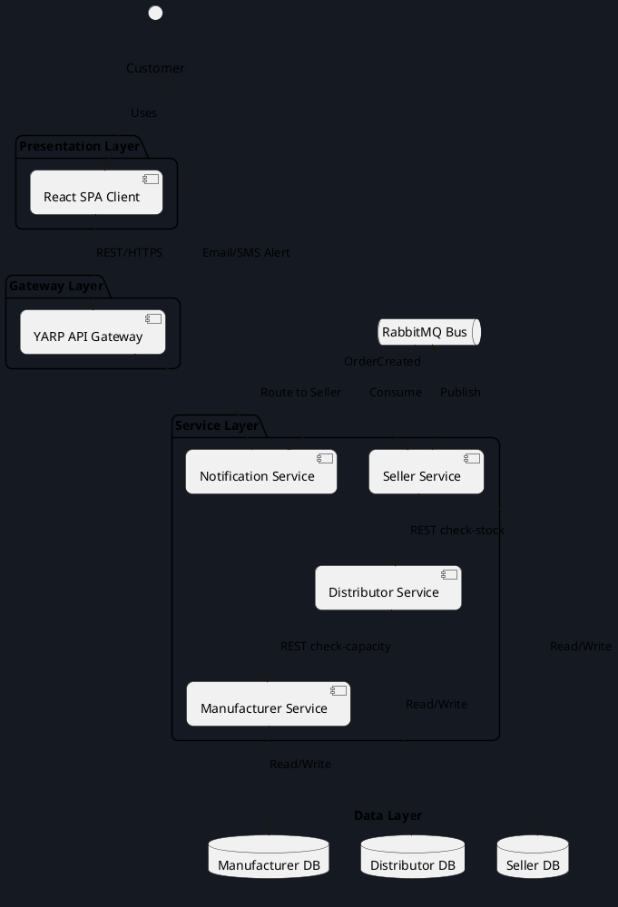

#### Mermaid
```mermaid
graph TD
    classDef default fill:#151922,stroke:#242b35,color:#f8fafc;
    classDef highlight fill:#f59e0b,stroke:#d97706,color:#0b0c10;

    Customer((Customer)) -->|HTTPS| WebApp[React Client]
    WebApp -->|HTTPS| Proxy[YARP API Gateway]
    Proxy -->|REST/JSON| Seller[Seller Service]
    Seller -->|REST/JSON| Dist[Distributor Service]
    Dist -->|REST/JSON| Mfg[Manufacturer Service]

    Seller Db[(Seller DB)] <--> Seller
    Dist Db[(Distributor DB)] <--> Dist
    Mfg Db[(Manufacturer DB)] <--> Mfg

    Seller -.->|Publish Event| RabbitMQ[RabbitMQ Broker]
    RabbitMQ -.->|Subscribe| Notif[Notification Service]
    Notif -->|SMS/Email| Customer

    class Seller,Dist,Mfg highlight;
```

### 3.2 Component Diagram
#### PlantUML
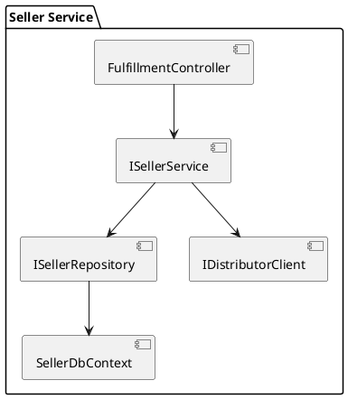

#### Mermaid
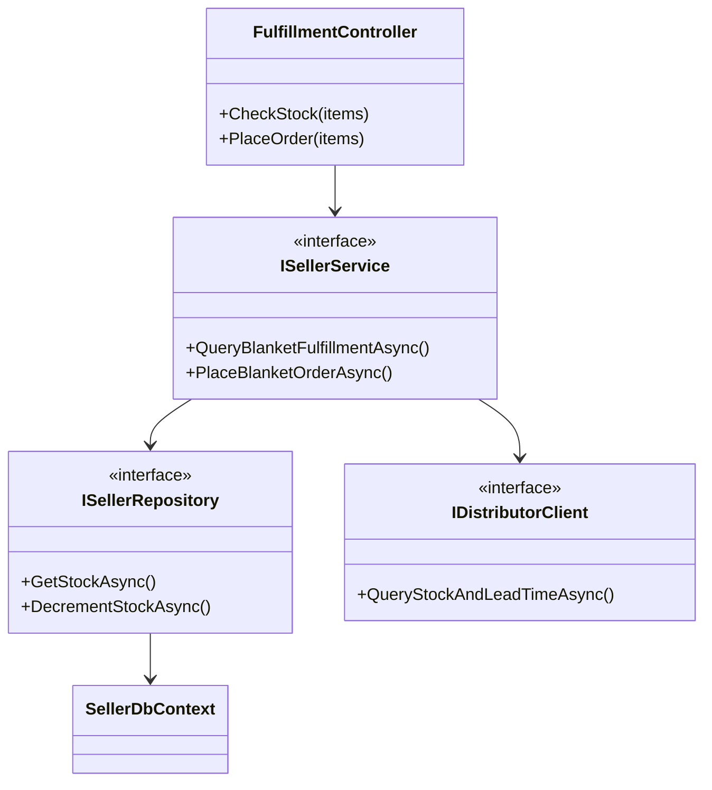

### 3.3 Service Communication Diagram
#### PlantUML
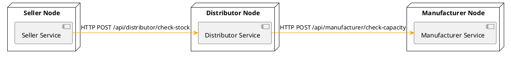

#### Mermaid
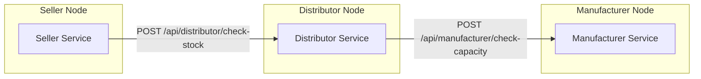

### 3.4 Sequence Diagram
#### PlantUML
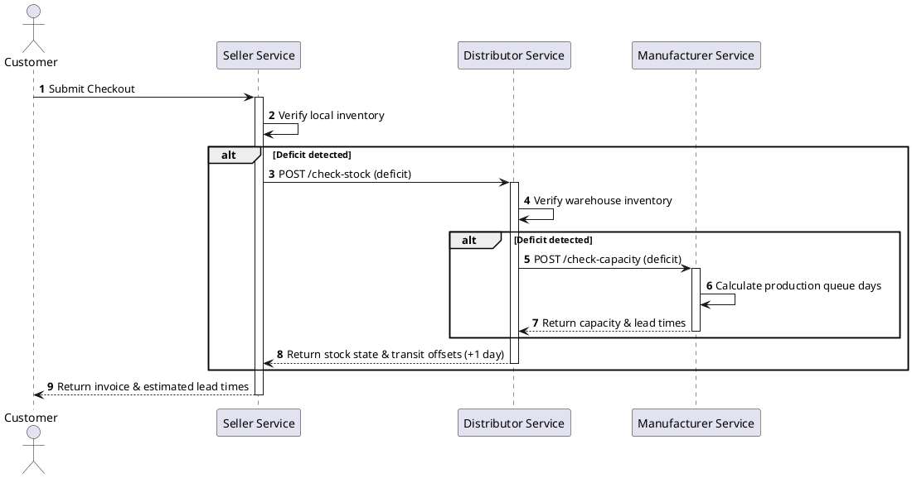

#### Mermaid
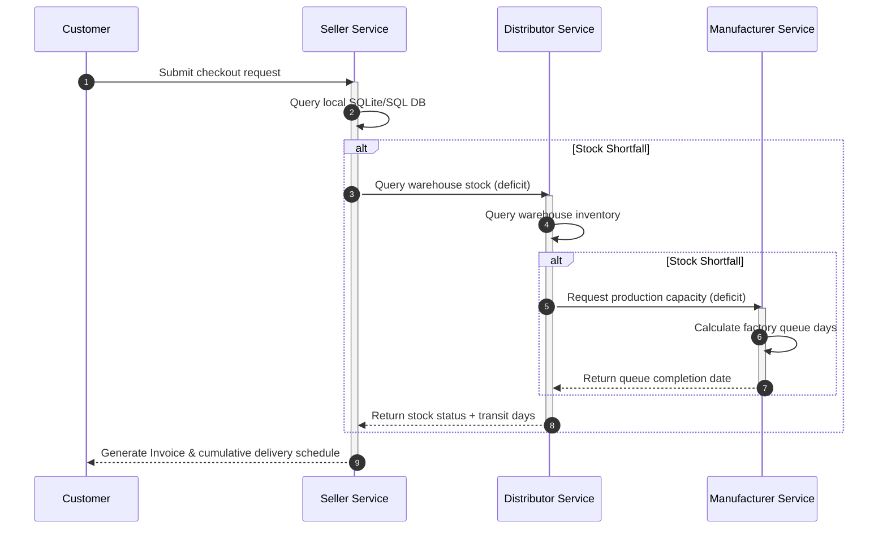

### 3.5 Use Case Diagram
#### PlantUML
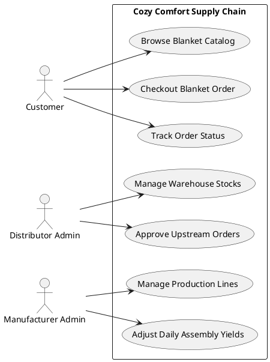

#### Mermaid
```mermaid
left-to-right direction
graph TD
    Customer((Customer)) --> UC1(Browse Blanket Catalog)
    Customer --> UC2(Checkout Blanket Order)
    Customer --> UC3(Track Order Status)

    DistAdmin((Distributor Admin)) --> UC4(Manage Warehouse Stocks)
    DistAdmin --> UC5(Approve Upstream Orders)

    MfgAdmin((Manufacturer Admin)) --> UC6(Manage Production Lines)
    MfgAdmin --> UC7(Adjust Daily Assembly Yields)
```

### 3.6 Deployment Diagram
#### PlantUML
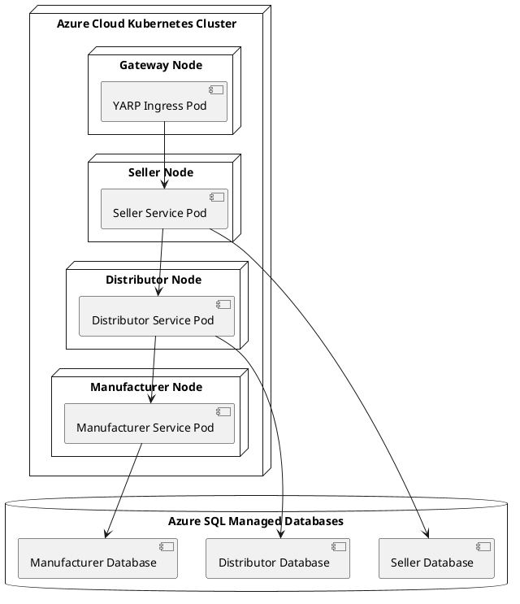

#### Mermaid
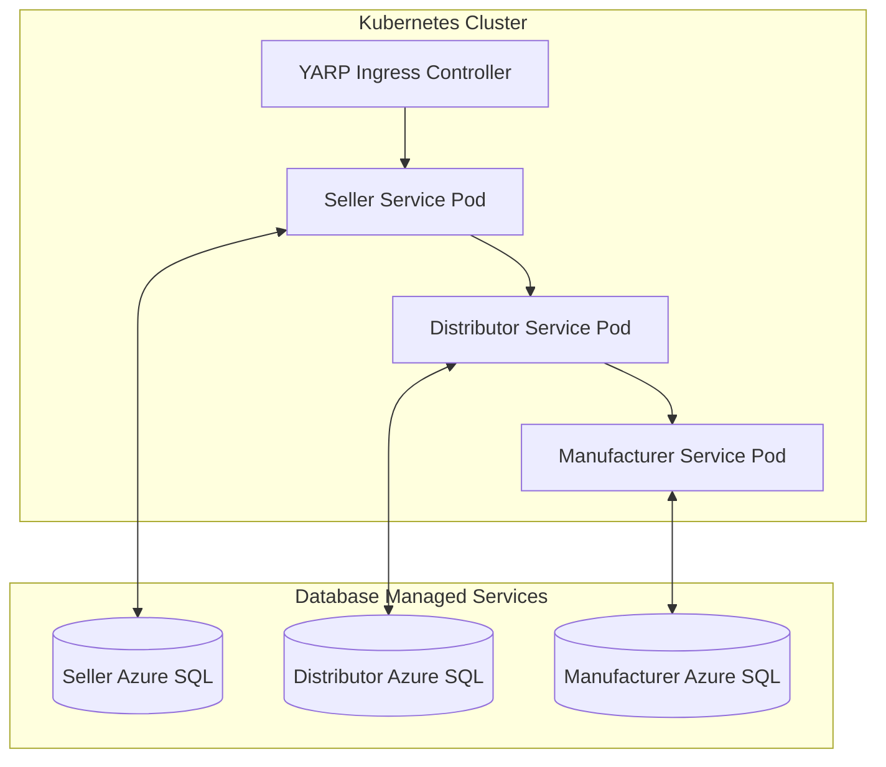

### 3.7 Database ER Diagram
#### PlantUML
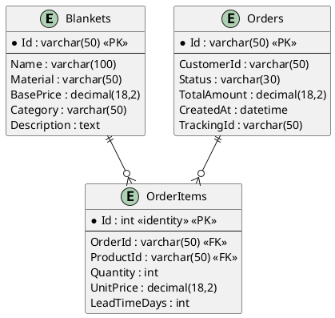

#### Mermaid
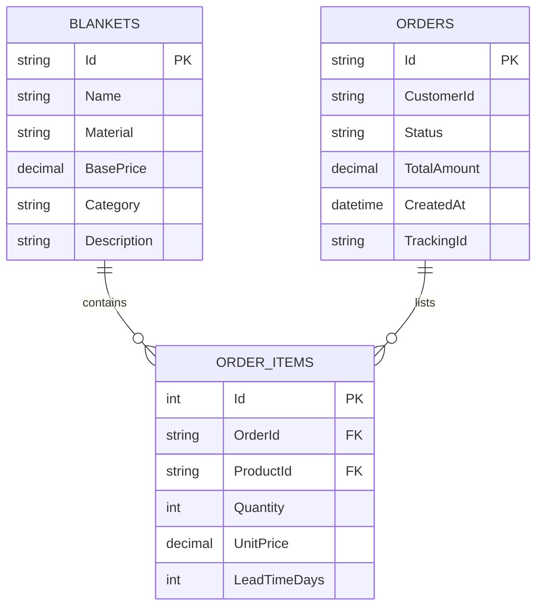

---

## 4. Phase 4 – Database Design

### 4.1 SQL Server CREATE TABLE Scripts

```sql
-- ==========================================
-- SELLER DATABASE DEFINITIONS
-- ==========================================
CREATE DATABASE CozyComfort_Seller;
GO
USE CozyComfort_Seller;
GO

CREATE TABLE Blankets (
    Id VARCHAR(50) PRIMARY KEY,
    Name VARCHAR(100) NOT NULL,
    Material VARCHAR(50) NOT NULL,
    BasePrice DECIMAL(18,2) NOT NULL,
    Category VARCHAR(50) NOT NULL,
    [Description] NVARCHAR(500) NULL,
    CreatedAt DATETIME DEFAULT GETUTCDATE()
);

CREATE TABLE Orders (
    Id VARCHAR(50) PRIMARY KEY,
    CustomerId VARCHAR(50) NOT NULL,
    Status VARCHAR(30) NOT NULL, -- e.g., 'Pending', 'Confirmed', 'Shipped'
    TotalAmount DECIMAL(18,2) NOT NULL,
    CreatedAt DATETIME DEFAULT GETUTCDATE(),
    TrackingId VARCHAR(50) NOT NULL
);

CREATE TABLE OrderItems (
    Id INT IDENTITY(1,1) PRIMARY KEY,
    OrderId VARCHAR(50) NOT NULL FOREIGN KEY REFERENCES Orders(Id) ON DELETE CASCADE,
    ProductId VARCHAR(50) NOT NULL FOREIGN KEY REFERENCES Blankets(Id),
    Quantity INT NOT NULL CHECK (Quantity > 0),
    UnitPrice DECIMAL(18,2) NOT NULL,
    LeadTimeDays INT NOT NULL
);

CREATE TABLE RetailInventory (
    ProductId VARCHAR(50) PRIMARY KEY FOREIGN KEY REFERENCES Blankets(Id),
    StockCount INT NOT NULL CHECK (StockCount >= 0)
);

CREATE INDEX IX_OrderItems_OrderId ON OrderItems(OrderId);
CREATE INDEX IX_OrderItems_ProductId ON OrderItems(ProductId);

-- ==========================================
-- DISTRIBUTOR DATABASE DEFINITIONS
-- ==========================================
CREATE DATABASE CozyComfort_Distributor;
GO
USE CozyComfort_Distributor;
GO

CREATE TABLE DistributorInventory (
    ProductId VARCHAR(50) PRIMARY KEY,
    StockCount INT NOT NULL CHECK (StockCount >= 0)
);

CREATE TABLE UpstreamPurchaseOrders (
    Id VARCHAR(50) PRIMARY KEY,
    ProductId VARCHAR(50) NOT NULL,
    Quantity INT NOT NULL CHECK (Quantity > 0),
    Status VARCHAR(30) NOT NULL,
    OrderedAt DATETIME DEFAULT GETUTCDATE()
);

-- ==========================================
-- MANUFACTURER DATABASE DEFINITIONS
-- ==========================================
CREATE DATABASE CozyComfort_Manufacturer;
GO
USE CozyComfort_Manufacturer;
GO

CREATE TABLE ManufacturerInventory (
    ProductId VARCHAR(50) PRIMARY KEY,
    StockCount INT NOT NULL CHECK (StockCount >= 0)
);

CREATE TABLE ProductionRequests (
    Id VARCHAR(50) PRIMARY KEY,
    ProductId VARCHAR(50) NOT NULL,
    Quantity INT NOT NULL CHECK (Quantity > 0),
    EstCompleteDate DATETIME NOT NULL,
    Status VARCHAR(30) NOT NULL
);
```

---

## 5. Phase 5 – API Design

### 5.1 ASP.NET Core Project Structure
```
/CozyComfort.API
  ├── CozyComfort.API.csproj
  ├── Program.cs
  ├── appsettings.json
  ├── /Controllers
  │     └── FulfillmentController.cs
  ├── /Services
  │     ├── ISellerService.cs
  │     ├── SellerService.cs
  │     ├── IDistributorService.cs
  │     ├── DistributorService.cs
  │     ├── IManufacturerService.cs
  │     └── ManufacturerService.cs
  ├── /Repositories
  │     ├── ISellerRepository.cs
  │     └── SellerRepository.cs
  ├── /Models
  │     └── DTOs.cs
  └── /Middleware
        └── ExceptionHandlingMiddleware.cs
```

### 5.2 Dependency Injection Setup (`Program.cs`)
```csharp
using CozyComfort.API.Services;
using CozyComfort.API.Middleware;

var builder = WebApplication.CreateBuilder(args);

// Add frameworks
builder.Services.AddControllers();

// Register Decoupled Services
builder.Services.AddSingleton<IManufacturerService, ManufacturerService>();
builder.Services.AddSingleton<IDistributorService, DistributorService>();
builder.Services.AddSingleton<ISellerService, SellerService>();

// CORS policies
builder.Services.AddCors(options =>
{
    options.AddPolicy("AllowViteClient",
        policy => policy.AllowAnyOrigin().AllowAnyHeader().AllowAnyMethod());
});

var app = builder.Build();

// Custom Middlewares
app.UseMiddleware<ExceptionHandlingMiddleware>();
app.UseCors("AllowViteClient");
app.UseAuthorization();
app.MapControllers();

app.Run();
```

### 5.3 Custom Middleware: Exception Handling
```csharp
namespace CozyComfort.API.Middleware;

using Microsoft.AspNetCore.Http;
using Microsoft.Extensions.Logging;
using System;
using System.Net;
using System.Text.Json;
using System.Threading.Tasks;

public class ExceptionHandlingMiddleware
{
    private readonly RequestDelegate _next;
    private readonly ILogger<ExceptionHandlingMiddleware> _logger;

    public ExceptionHandlingMiddleware(RequestDelegate next, ILogger<ExceptionHandlingMiddleware> logger)
    {
        _next = next;
        _logger = logger;
    }

    public async Task InvokeAsync(HttpContext context)
    {
        try
        {
            await _next(context);
        }
        catch (Exception ex)
        {
            _logger.LogError(ex, "An unhandled exception occurred during transaction processing.");
            await HandleExceptionAsync(context, ex);
        }
    }

    private static Task HandleExceptionAsync(HttpContext context, Exception exception)
    {
        context.Response.ContentType = "application/json";
        context.Response.StatusCode = (int)HttpStatusCode.InternalServerError;

        var response = new
        {
            StatusCode = context.Response.StatusCode,
            Message = "Internal Server Error in Cozy Comfort SOC pipeline.",
            Detailed = exception.Message
        };

        return context.Response.WriteAsync(JsonSerializer.Serialize(response));
    }
}
```

---

## 6. Phase 6 – Implementation Plan

### 6.1 Roadmap & Build Order
```
┌─────────────────┐      ┌─────────────────┐      ┌─────────────────┐
│ 1. Database DDL │ ───> │ 2. Manufacturer │ ───> │ 3. Distributor  │
│    Deployments  │      │    Service Core │      │    Service Core │
└─────────────────┘      └─────────────────┘      └─────────────────┘
                                                           │
┌─────────────────┐      ┌─────────────────┐               │
│ 6. End-to-End   │ <─── │ 5. Gateway &    │ <─── ┌────────▼────────┐
│    Integration  │      │    Broker Setup │      │ 4. Seller API   │
└─────────────────┘      └─────────────────┘      │    Endpoints    │
                                                  └─────────────────┘
```

### 6.2 Recommended NuGet Packages
1. `Microsoft.EntityFrameworkCore.SqlServer`: Connects to MS SQL Server instances.
2. `Serilog.AspNetCore`: Structured logging framework.
3. `RabbitMQ.Client`: Message broker for event notifications.
4. `Yarp.ReverseProxy`: Light Gateway management.

### 6.3 Test Strategy
*   **Unit Tests**: Validate lead time math calculations inside the `ManufacturerService` using xUnit.
*   **Integration Tests**: Mock HTTP endpoints to verify correct stock escalation paths.
*   **End-to-End Tests**: Automated checks verifying inventory deductions from the Seller down to the Manufacturer.

---

## 7. Phase 8 – Deployment

### 7.1 IIS Deployment Web.config
For hosting in local IIS instances, configure the ASP.NET Core module:
```xml
<?xml version="1.0" encoding="utf-8"?>
<configuration>
  <location path="." inheritInChildApplications="false">
    <system.webServer>
      <handlers>
        <add name="aspNetCore" path="*" verb="*" modules="AspNetCoreModuleV2" resourceType="Unspecified" />
      </handlers>
      <aspNetCore processPath="dotnet" arguments=".\CozyComfort.API.dll" stdoutLogEnabled="true" stdoutLogFile=".\logs\stdout" hostingModel="inprocess" />
    </system.webServer>
  </location>
</configuration>
```

### 7.2 Docker Compose Orchestration Setup
```yaml
version: '3.8'

services:
  sql-server:
    image: mcr.microsoft.com/mssql/server:2022-latest
    environment:
      - ACCEPT_EULA=Y
      - MSSQL_SA_PASSWORD=CozySecurePass123!
    ports:
      - "1433:1433"

  seller-service:
    build:
      context: .
      dockerfile: Dockerfile
    environment:
      - ConnectionStrings__SellerDb=Server=sql-server;Database=CozyComfort_Seller;User Id=sa;Password=CozySecurePass123!;TrustServerCertificate=True;
    ports:
      - "5111:8080"
    depends_on:
      - sql-server
```

### 7.3 Kubernetes Cluster Pod Specifications
```yaml
apiVersion: apps/v1
kind: Deployment
metadata:
  name: seller-service-deployment
  namespace: cozy-comfort
spec:
  replicas: 2
  selector:
    matchLabels:
      app: seller-service
  template:
    metadata:
      labels:
        app: seller-service
    spec:
      containers:
      - name: seller-api
        image: cozycomfort/seller-service:1.0.0
        ports:
        - containerPort: 8080
        resources:
          limits:
            cpu: "500m"
            memory: "512Mi"
          requests:
            cpu: "250m"
            memory: "256Mi"
---
apiVersion: v1
kind: Service
metadata:
  name: seller-service
  namespace: cozy-comfort
spec:
  ports:
  - port: 80
    targetPort: 8080
  selector:
    app: seller-service
```
