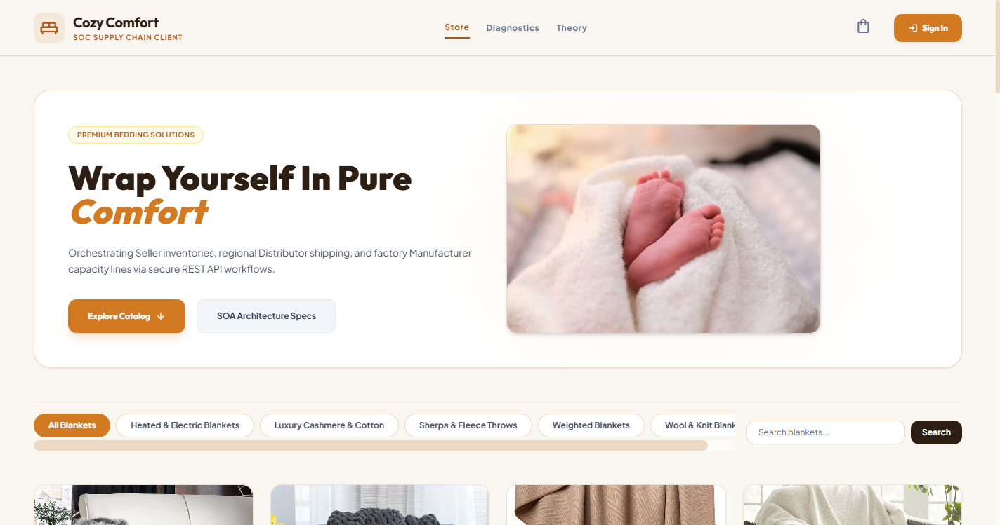
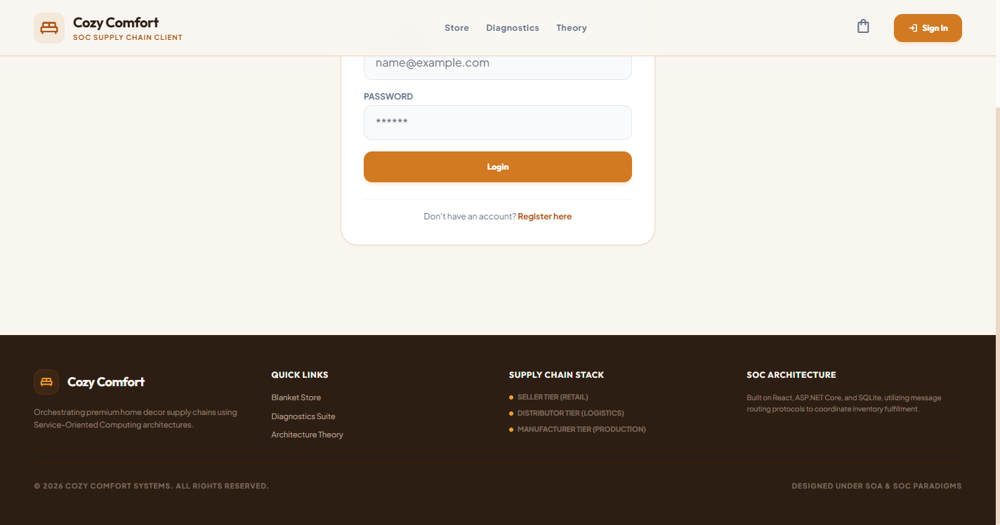
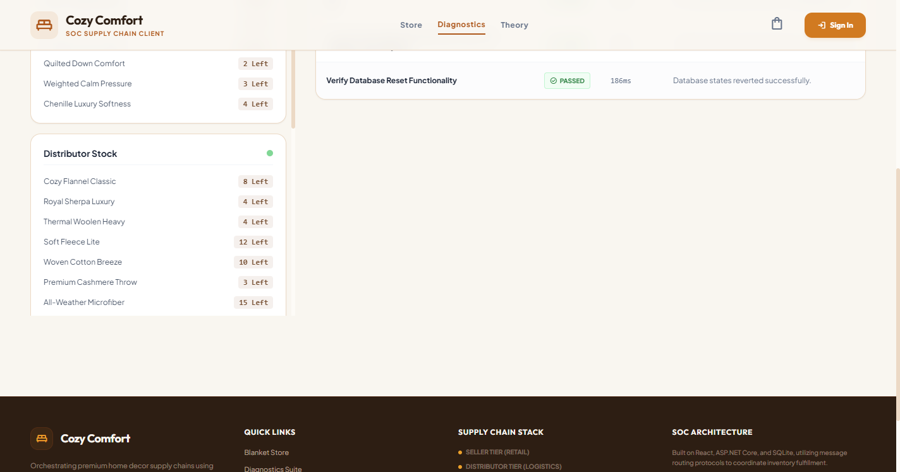
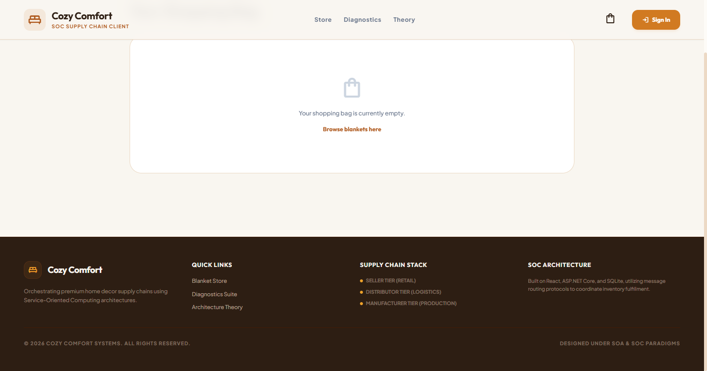
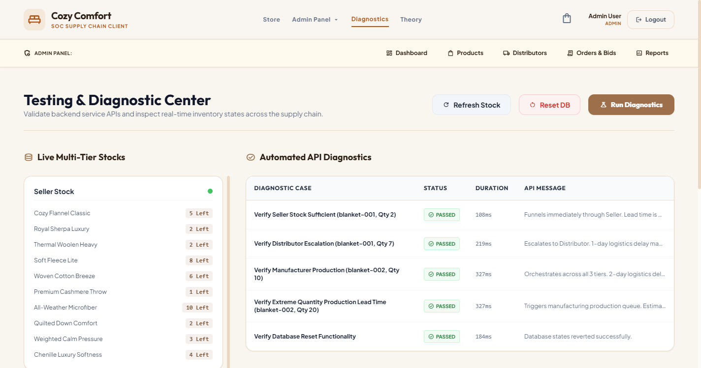
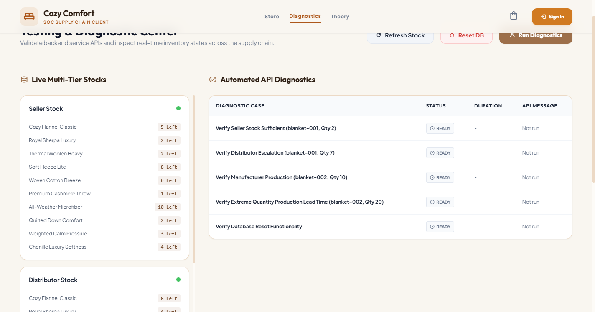
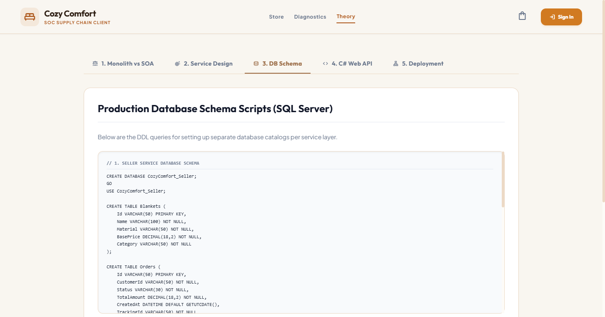

# Cozy Comfort (v2) - SOC Blanket Supply Chain Solution

This repository contains the Service-Oriented Computing (SOC) based blanket supply chain solution for **Cozy Comfort**. It integrates a React frontend client with an ASP.NET Core Web API backend to manage a distributed inventory system, catalog, shopping cart, admin workflows, and distributor order-bidding protocols.

## Directory Structure

* [App.tsx](./App.tsx): The main React application managing cart states, logs, and navigation.
* [components/](./components/):
  * [SupplyChainVisualizer.tsx](./components/SupplyChainVisualizer.tsx): Interactive visualization of query trace logs.
  * [TestDashboard.tsx](./components/TestDashboard.tsx): Live in-memory inventory viewer and endpoint diagnostic tool.
  * [TheoryView.tsx](./components/TheoryView.tsx): Project documentation and monolithic vs SOA architecture analysis.
* [backend/](./backend/):
  * [CozyComfort.API/](./backend/CozyComfort.API/): ASP.NET Core Web API project.
  * [CozyComfort.Tests/](./backend/CozyComfort.Tests/): xUnit test suite for supply chain validation.

## Running Locally

### Prerequisites

* [.NET 8.0 SDK](https://dotnet.microsoft.com/download/dotnet/8.0)
* [Node.js](https://nodejs.org/) (Version 18 or above recommended)

### Step-by-Step Launch

1. **Kill any old instances** and run both servers automatically using PowerShell:

   ```powershell
   ./restart_app.ps1
   ```
2. Alternatively, launch them manually in separate terminal windows:

   * **Backend API**:
     ```bash
     cd backend
     dotnet run
     ```
   * **Frontend Client**:
     ```bash
     npm install
     npm run dev
     ```
3. The frontend client will run on `http://localhost:3000` and the API will listen on `http://localhost:5262`.

## Seeded User Credentials

The system includes pre-seeded user accounts for testing. All seeded accounts share the same default password:

* **Default Password:** `Password123!`

| Role               | Email                      | Name       |
| :----------------- | :------------------------- | :--------- |
| **Admin**    | `admin@cozycomfort.com`  | Admin User |
| **Customer** | `john.doe@example.com`   | John Doe   |
| **Customer** | `jane.smith@example.com` | Jane Smith |

---

## Screenshots Showcase

Below are key screenshots of the Cozy Comfort system in action:

### 1. Catalog Page
A responsive, high-performance storefront allowing customers to browse premium blankets with live stock checks.


### 2. Secure Login Portal
Seeded authentication role routing (Admin vs Customer).


### 3. Admin Control Center
Manage distributor relations, update product stock levels, and coordinate logistics.


### 4. Distributor Diagnostics
Real-time distributor endpoint pinging and status check.


### 5. Automated Endpoint Verification
Diagnostics dashboard displaying successful checks across all API nodes.


### 6. Supply Chain Test Bench
Live database status and custom mock request testing utility.


### 7. End-to-End Query Trace Visualizer
Trace queries through SOAP/REST service boundaries to monitor performance.


### 8. System Database Relationship Design
Relational schema mapping customer profiles, orders, distributor bids, and catalog items.

